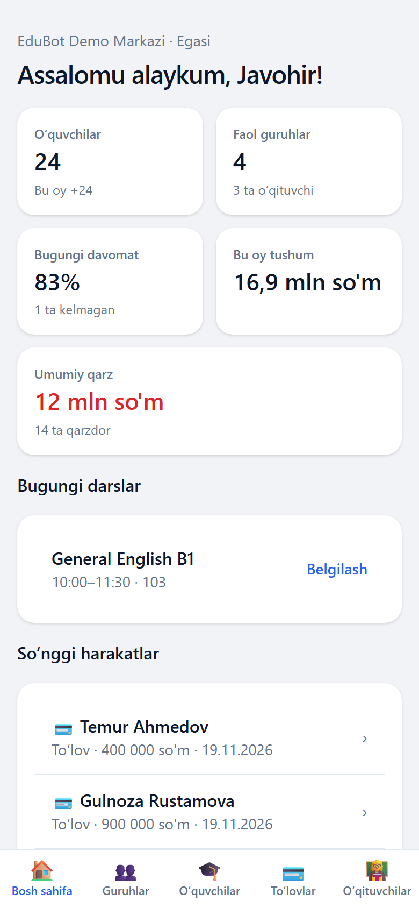
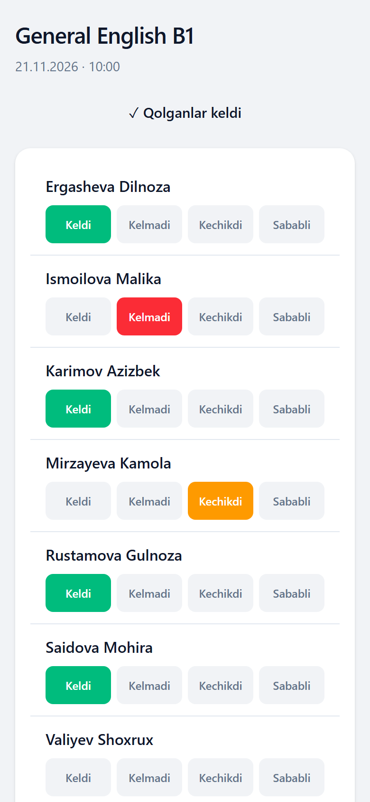
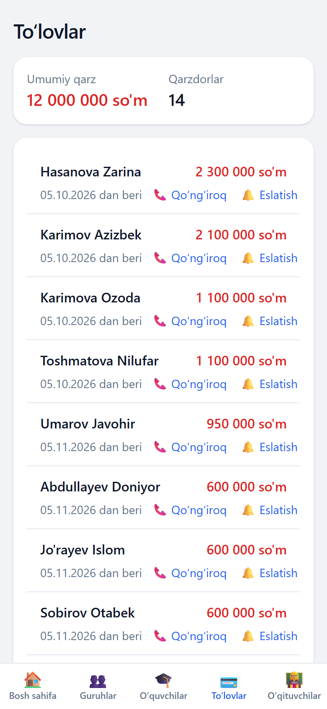
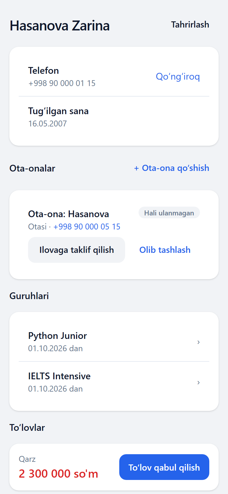
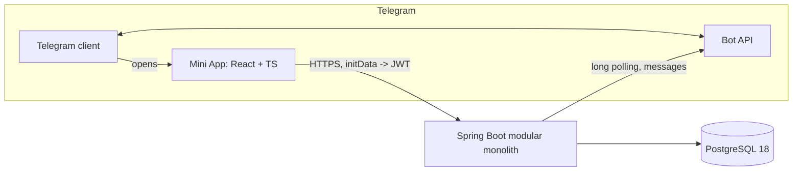

# EduBot

Education center management SaaS for Uzbekistan, delivered as a **Telegram Bot + Telegram Mini App**
on top of a Spring Boot API. Owners run their center from Telegram: students, groups, attendance,
tuition and parent notifications — no desktop software, no training.

[](https://github.com/Javohir004/EduBot/actions/workflows/ci.yml)

| Home | Attendance | Debtors | Student |
|---|---|---|---|
|  |  |  |  |

*Demo data ("EduBot Demo Markazi"), Uzbek interface. More in [docs/screenshots](docs/screenshots).*

## Who does what

| Role | Who | What they do in the app |
|---|---|---|
| **Platform admin** | EduBot owner (Telegram id in `PLATFORM_ADMIN_TELEGRAM_IDS`) | Creates centers with a trial, sends the owner a one-time invite, renews or changes plans |
| **Owner** | Center director | Everything in the center: students, teachers, groups, payments; sees revenue; voids payments; manages staff and settings |
| **Admin** | Reception / manager | Students, groups, attendance, records payments, invites teachers and parents; no revenue, cannot void |
| **Teacher** | Teacher | Sees only own groups; marks attendance for today's lessons (can correct for 2 days) |
| **Parent** | Mother / father | Read-only: own children, last 30 days of attendance, debt; receives absence and payment messages in Telegram |

Everyone joins with a one-time invite link opened in the bot and confirmed by sharing their own
Telegram phone number, which must match the number the center entered.

## Main flows

1. **Teacher marks attendance** (Home → Today's lessons) → parents of absent students get a Telegram
   message after 15 minutes (cancelled if the teacher corrects the mark).
2. **Admin records a payment** → it pays the oldest month first; overpayment becomes credit; a
   double tap never records it twice.
3. **Owner opens Payments** → debtors with total debt, one-tap call or reminder to the parent.

## Architecture



Modular monolith with module boundaries verified by Spring Modulith; shared-schema multi-tenancy
(`center_id` + Hibernate `@TenantId`, composite foreign keys); notifications through a
transactional outbox. Details: [docs/architecture.md](docs/architecture.md) ·
security review: [docs/security.md](docs/security.md).

## Stack

Java 21 · Spring Boot 4 · Spring Security (JWT) · Spring Data JPA / Hibernate 7 · PostgreSQL 18 ·
Flyway · TelegramBots · ShedLock · Bucket4j · Testcontainers · React 19 · TypeScript · Vite ·
Tailwind CSS 4 · TanStack Query · Vitest · Docker · GitHub Actions

## Features

- Telegram Mini App authentication: `initData` HMAC validation per Telegram's procedure, no auth bypass;
  JWT carries ids only, roles re-read from the database on every request
- Multi-tenant isolation tested on every endpoint (another center's ids return 404)
- Students, parents (shared by siblings), teachers, groups, weekly schedules, enrollments with history
- Attendance (present / absent / late / excused), monthly attendance grid
- Tuition billing: monthly charges, individual fees, FIFO allocation, credit, voids with audit log, debtors
- Notifications: absence messages, weekly payment reminders, subscription expiry reminders
  (dedup keys, quiet hours 22:00–08:00 Tashkent)
- Subscriptions with plan limits stored as data; read-only mode after expiry (data is never deleted)
- Parent view, owner dashboard, staff management, settings; Uzbek and Russian UI
- Rate limiting, RFC 9457 errors, demo data profile

## Run locally

Prerequisites: JDK 21, Docker Desktop, Git, Node.js LTS, cloudflared (for opening the Mini App from Telegram).

```bash
cp .env.example .env          # then fill TELEGRAM_BOT_TOKEN, JWT_SECRET, DB_PASSWORD
docker compose up -d          # PostgreSQL 18 on localhost:5433
cd backend && ./mvnw spring-boot:run
```

- Health: http://localhost:8080/actuator/health
- Swagger UI (when `API_DOCS_ENABLED=true`): http://localhost:8080/swagger-ui.html
- Migrations run automatically on startup.

Run the backend in Docker instead: `docker compose --profile app up -d --build`.

### Open the Mini App in Telegram (local) — two steps

Telegram opens Mini Apps only over HTTPS. One script prepares everything:

```powershell
.\scripts\dev.ps1        # PostgreSQL + builds web/dist + Cloudflare tunnel; writes MINI_APP_URL to .env
```

Then press **Run** in IntelliJ (or `cd backend && ./mvnw spring-boot:run`). The backend serves the
built Mini App itself (`FRONTEND_DIST_DIR`) and, on startup, points the bot's menu button at the new
tunnel URL — nothing to change in @BotFather. Keep the script window open (it holds the tunnel).

Frontend hot reload while editing UI code: `cd web && npm run dev` (http://localhost:5173, proxies `/api`).

### Demo data

Start the backend with the `demo` profile to get a clearly named demo center
("EduBot Demo Markazi": 24 students, 4 groups, 2 weeks of attendance, payments).
Phones are fictional and guardians are not linked, so nobody receives messages.

```bash
SPRING_PROFILES_ACTIVE=demo DEMO_OWNER_TELEGRAM_ID=<your telegram id> ./mvnw spring-boot:run
```

### Open the Mini App in a normal browser (development)

There is no auth bypass. `web/scripts/dev-init-data.mjs` signs initData exactly like Telegram,
using the dev bot token from `.env`, and prints a URL that `telegram-web-app.js` understands:

```bash
cd web && node scripts/dev-init-data.mjs <telegramUserId> [firstName] [baseUrl]
```

## Tests

```bash
cd backend && ./mvnw verify   # unit + integration tests (needs Docker for Testcontainers)
cd web && npm test            # frontend unit/component tests
```

## API

| Method | Path | Auth | Purpose |
|---|---|---|---|
| POST | `/api/v1/auth/telegram` | – | Exchange Telegram `initData` for an access token |
| POST | `/api/v1/auth/session` | Bearer | Bind the token to one of the user's memberships |
| GET | `/api/v1/me` | Bearer | Current user, memberships, active membership |
| POST/GET | `/api/v1/invites` | `INVITE_*` | Create / list pending invites of the current center |
| DELETE | `/api/v1/invites/{id}` | `INVITE_*` | Revoke an invite |
| POST/GET | `/api/v1/platform/centers` | `PLATFORM_MANAGE` | Create center (trial + owner invite) / list centers |
| PATCH | `/api/v1/platform/centers/{id}/status` | `PLATFORM_MANAGE` | Activate / suspend / deactivate |
| GET | `/api/v1/platform/plans` | `PLATFORM_MANAGE` | Subscription plans |
| GET/POST/PUT | `/api/v1/students[/{id}]` | `STUDENT_*` | Search, create (with guardians), update with `version` |
| POST | `/api/v1/students/{id}/archive` · `/restore` | `STUDENT_WRITE` | Archive instead of delete |
| POST/DELETE | `/api/v1/students/{id}/guardians[/{gid}]` | `STUDENT_WRITE` | Link / unlink a guardian (shared by phone) |
| POST | `/api/v1/students/{id}/guardians/{gid}/invite` | `INVITE_STAFF` | One-time parent invite link |
| GET/POST/PUT | `/api/v1/teachers[/{id}]` | `TEACHER_MANAGE` | Teachers; `/archive`, `/restore`, `/invite` |
| GET/POST/PUT | `/api/v1/groups[/{id}]` | `GROUP_*` | Groups (teachers see only their own); `/complete` |
| PUT | `/api/v1/groups/{id}/schedule` | `GROUP_WRITE` | Replace weekly schedule |
| GET/POST | `/api/v1/groups/{id}/members` · `/enrollments` | `GROUP_*` | Members / enroll a student |
| POST/PUT | `/api/v1/enrollments/{id}/end` · `/fee` | `GROUP_WRITE` | Leave group / individual fee |
| GET | `/api/v1/lessons/today` | `ATTENDANCE_MARK` | Today's scheduled lessons with marking progress |
| POST | `/api/v1/groups/{id}/lessons` | `ATTENDANCE_MARK` | Open (get-or-create) a lesson |
| GET/PUT | `/api/v1/lessons/{id}/attendance` | `ATTENDANCE_MARK` | Roster and bulk marking (upsert); absences notify parents |
| GET | `/api/v1/groups/{id}/attendance?month=` | `ATTENDANCE_MARK` | Monthly attendance grid |
| GET | `/api/v1/students/{id}/balance` | `PAYMENT_READ` | Debt, credit, charges, payments |
| POST | `/api/v1/students/{id}/payments` | `PAYMENT_WRITE` | Record payment (`Idempotency-Key` header), FIFO allocation |
| POST | `/api/v1/payments/{id}/void` | `PAYMENT_VOID` | Void with reason (audited) |
| PUT/POST | `/api/v1/charges/{id}` · `/void` | `PAYMENT_VOID` | Correct or void a charge (audited) |
| GET | `/api/v1/debtors` | `PAYMENT_READ` | Debtors with totals and parent phone |
| POST | `/api/v1/debtors/{studentId}/remind` | `PAYMENT_WRITE` | Send a payment reminder to linked parents now |
| GET | `/api/v1/subscription` | `CENTER_READ` | Plan, phase (ACTIVE/GRACE/EXPIRED), usage and limits |
| POST | `/api/v1/platform/centers/{id}/subscriptions` | `PLATFORM_MANAGE` | Renew / change plan manually |
| GET/PUT | `/api/v1/center/settings` | `CENTER_*` | Notification toggles, payment due day |
| GET/DELETE | `/api/v1/staff[/{membershipId}]` | `STAFF_MANAGE` | Staff list, revoke access |
| GET | `/api/v1/parent/children[/{id}]` | `CHILD_READ` | Parent view: own children, attendance, debt |
| GET | `/api/v1/dashboard/summary` | `STUDENT_READ` | Key figures (revenue for owners, debt for payment readers) |
| GET | `/api/v1/activity` | `PAYMENT_READ` | Latest students, payments and voids |
