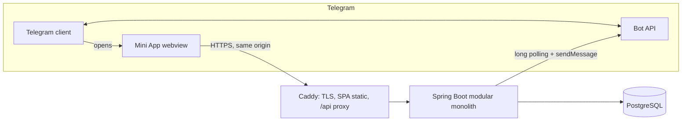
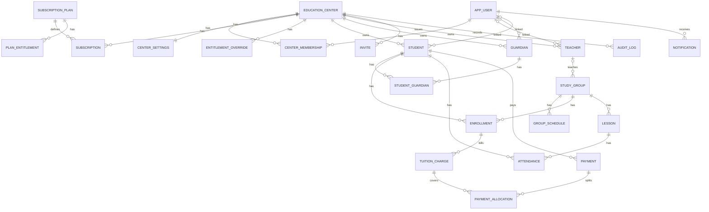
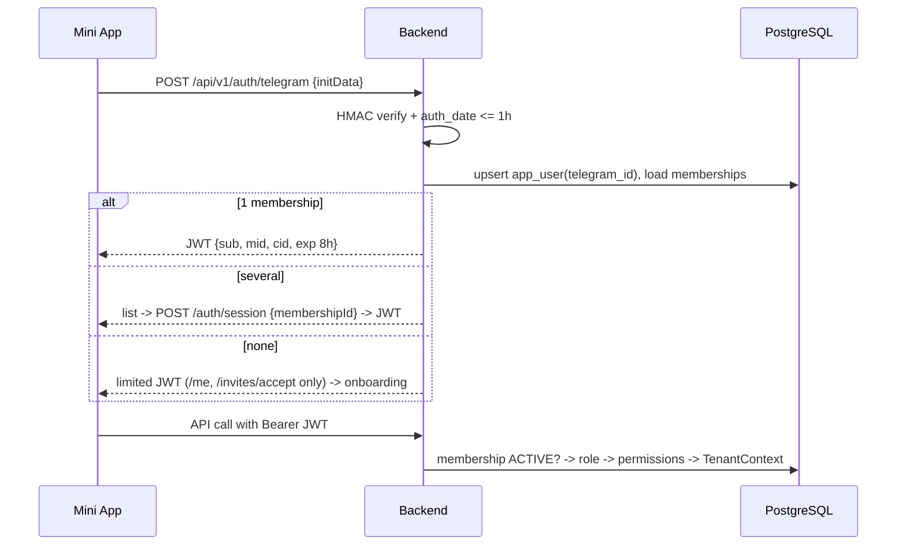

# EduBot — Architecture

> Status: **approved v1** (2026-11-19). Library versions are verified against official sources when the project is scaffolded (Day 1); this document records decisions, not pinned versions.

EduBot is a multi-tenant SaaS for private education centers in Uzbekistan, delivered as a Telegram Bot + Telegram Mini App backed by a Spring Boot API.

---

## 1. Product focus

The MVP must do three things perfectly:

1. A teacher marks attendance in ~30 seconds → parents of absent students get a Telegram message automatically.
2. An admin records a payment → the student's debt is recalculated immediately.
3. The owner opens the debtor list and sends reminders with one tap.

| Actor | Device | Needs |
|---|---|---|
| Owner / Admin | Phone + Telegram Desktop | Fast CRUD, money, reports |
| Teacher | Phone, during class | One-screen attendance |
| Parent | Phone, low tech literacy | Read-only: attendance, balance |
| Super Admin | Phone / desktop | Centers, plans, subscriptions |

Locale: `uz-Latn` (primary), `ru` (second), UZS, `Asia/Tashkent` (UTC+5, no DST), phones normalized to E.164 (`+998XXXXXXXXX`).

## 2. Known risks and gaps

| Risk / gap | Decision |
|---|---|
| Many centers bill per 12-lesson cycle, not per calendar month | MVP bills per calendar month; schema uses `period_start/period_end` so cycle billing can be added |
| Individual fees and discounts | `enrollment.fee_override` |
| Mid-month joins | Admin edits the charge amount (MVP); automatic proration later |
| Owner does not want reception staff to see revenue | Separate `OWNER` and `ADMIN` roles, permission-based checks |
| "Excused" absences are common | Attendance statuses: `PRESENT`, `ABSENT`, `LATE`, `EXCUSED` |
| Bots cannot message users who never pressed `/start` | Account linking always goes through the bot chat |
| Parents without Telegram | Accepted for MVP; SMS fallback is a future feature |
| **Personal data law (ZRU-547, 2021 localization requirement)** | Demo may run on any VPS. **Before commercial launch: legal review + hosting inside Uzbekistan** |
| Local competitors exist (e.g. Modme) | Differentiation: Telegram-native, automatic parent notifications, zero training. To be validated with 5–10 centers |
| Multi-branch centers | Post-MVP; tenant stays `center`, `branch_id` added later |

## 3. Architecture

**Modular monolith**: one Spring Boot application (REST API + bot module + scheduler), PostgreSQL, and a static React SPA served by Caddy.



Rules:

- The bot module is an adapter only; it calls services and contains no business logic.
- Feature modules never touch another module's repositories — only its services or events. Enforced by a Spring Modulith `ApplicationModules.verify()` test.
- SPA and API share one origin in production, so CORS is disabled outside the `dev` profile.

### Decisions and trade-offs

| Topic | Options | Decision | Why |
|---|---|---|---|
| Style | Microservices / Modular monolith | Modular monolith | One developer, short timeline; microservices add only ops cost |
| Bot placement | Separate service / Inside monolith | Inside | Single deploy, shared services |
| Bot updates | Webhook / Long polling | Long polling (MVP) | No public bot endpoint or webhook secret; limitation: single instance. Switch to webhook when scaling out |
| Session | Server session / JWT | Short JWT + membership loaded from DB on every request | Cookies are unreliable in webviews; DB lookup gives immediate revocation |
| Super Admin UI | Separate web app / Same SPA | Same SPA, `/platform` route, lazy-loaded chunk | Half the work; backend `/api/v1/platform/**` requires `SUPER_ADMIN` |
| Cache / Redis | Yes / No | No | Nothing to cache; Bucket4j (in-memory) for rate limits, ShedLock (JDBC) for scheduler locks |
| Reverse proxy | Nginx / Caddy | Caddy | Automatic HTTPS; Mini Apps require HTTPS |
| Telegram SDK | Community SDK / Official `telegram-web-app.js` | Official script + thin typed wrapper | Community SDK had several breaking renames; we need ~10 APIs |
| Test DB | H2 / Testcontainers | Testcontainers PostgreSQL | H2 differs on partial indexes, jsonb, `ON CONFLICT`, pg_trgm |
| DTO mapping | MapStruct / Manual | Manual (records + static mappers) | Fewer annotation-processor issues, simpler code |
| Primary keys | bigint / UUID | UUID v7 | No enumerable IDs (defense in depth), index-friendly ordering |

## 4. Technology stack

| Layer | Choice |
|---|---|
| Language | Java 21 LTS |
| Framework | Spring Boot 4.x (3.5 OSS support ended June 2026) |
| Security | Spring Security + `oauth2-resource-server` (Nimbus, HS256) |
| Persistence | Spring Data JPA, Hibernate 7, PostgreSQL 18, Flyway |
| API docs | springdoc-openapi (Boot 4 compatible line) |
| Bot | TelegramBots (rubenlagus) 10.x, long polling |
| Rate limiting | Bucket4j |
| Scheduling | `@Scheduled` + ShedLock (JDBC) |
| Backend tests | JUnit 5, Mockito, Spring Boot Test, Testcontainers, Spring Modulith test |
| Frontend | React 19, TypeScript, Vite, Tailwind CSS 4, TanStack Query 5, React Router 7, react-hook-form + zod, i18next |
| Frontend tests | Vitest, Testing Library, MSW (Playwright: should-have) |
| API types | `openapi-typescript` generated from the backend spec |
| Runtime | Node LTS (build), Docker, Caddy 2 |

## 5. Backend package structure

Package-by-feature. Each feature has `web/` (controllers + request/response records), `*Service` classes, and `domain/` (entities + repositories). No interfaces for single-implementation services.

```
uz.edubot
├── common/        # open module: error (ProblemDetail), web (PageResponse), time (Clock), money, phone
├── user/          # app_user (Telegram identity), UserService
├── security/      # telegram/InitDataValidator, JWT, auth endpoints, Permission, AccessPolicy
├── tenancy/       # TenantContext, TenantIdentifierResolver, TenantScopedEntity
├── center/        # center profile, settings, staff (memberships)
├── invite/        # invite create / accept / revoke
├── student/       # student, guardian, student_guardian
├── teacher/
├── group/         # study_group, schedule, enrollment
├── attendance/    # lesson, attendance
├── billing/       # charge, payment, allocation, debtor queries
├── subscription/  # plans, entitlements, EntitlementService, expiry job
├── notification/  # outbox, sender worker, templates (uz/ru)
├── bot/           # Telegram adapter only -> calls services
├── dashboard/     # read-only aggregate queries
├── audit/
└── platform/      # super admin endpoints
```

## 6. Frontend structure

```
web/src
├── app/          # providers, router, auth bootstrap, role-based home
├── shared/
│   ├── api/      # fetch client, generated types, error mapping
│   ├── telegram/ # useTelegram, MainButton, BackButton, haptics, theme -> CSS vars
│   ├── ui/       # Button, ListItem, Sheet, ConfirmDialog, EmptyState, Skeleton
│   ├── i18n/     # uz.json, ru.json
│   └── lib/      # formatMoney (UZS), formatDate (Tashkent), phone
└── features/
    ├── onboarding/ dashboard/ students/ teachers/ groups/
    ├── attendance/ payments/ settings/ parent/ platform/
    └── <feature>/{api.ts, pages/, components/, schema.ts}
```

UX: bottom tab bar (Home / Students / Groups / Payments / More); teacher home is "Today's lessons"; form submit via Telegram `MainButton`; Telegram `themeParams` mapped to CSS variables used by Tailwind.

## 7. Domain model

Conventions: every tenant table has `center_id NOT NULL` and `UNIQUE (center_id, id)`; UUID v7 primary keys; `timestamptz` stored in UTC; local business dates as `DATE`; money as `NUMERIC(15,2)` / `BigDecimal`. Important records are archived or voided, never physically deleted.

| Entity | Key fields | Constraints / notes |
|---|---|---|
| `app_user` | telegram_id, names, username, language, verified_phone, platform_role, bot_blocked | `UNIQUE (telegram_id)`; global, not tenant-scoped |
| `education_center` | name, timezone, currency, default_language, status (`PENDING`/`ACTIVE`/`SUSPENDED`/`DEACTIVATED`) | Tenant root |
| `center_settings` | payment_due_day, absence_notify, reminder_policy, quiet_hours | 1:1 with center |
| `center_membership` | user_id, role (`OWNER`/`ADMIN`/`TEACHER`/`PARENT`), status | `UNIQUE (center_id, user_id, role)` |
| `teacher` | user_id?, full_name, phone, status | Can exist before the person links Telegram |
| `student` | user_id?, names, birth_date, phone?, status (`ACTIVE`/`ARCHIVED`), version | pg_trgm GIN index for name search |
| `guardian` | user_id?, full_name, phone | `UNIQUE (center_id, phone)` |
| `student_guardian` | student_id, guardian_id, relation, is_primary | Composite FKs through `center_id` |
| `study_group` | teacher_id?, name, subject, monthly_fee, start/end date, status, version | `CHECK (monthly_fee >= 0)` |
| `group_schedule` | day_of_week, start_time, end_time, room | `CHECK (end_time > start_time)` |
| `enrollment` | student_id, group_id, joined_on, left_on?, status, fee_override? | Partial unique: one `ACTIVE` row per student+group; history kept |
| `lesson` | group_id, lesson_date, start_time, status (`HELD`/`CANCELLED`) | `UNIQUE (group_id, lesson_date, start_time)`; created when attendance is opened |
| `attendance` | lesson_id, student_id, status, marked_by, marked_at | `UNIQUE (lesson_id, student_id)` + upsert |
| `tuition_charge` | enrollment_id, student_id, period_start/end, amount, paid_amount, due_date, status | `UNIQUE (enrollment_id, period_start)` → idempotent generation |
| `payment` | student_id, amount, method, paid_at, received_by, status (`ACTIVE`/`VOIDED`), void fields, idempotency_key, provider, provider_txn_id | `CHECK (amount > 0)`; never updated, only voided |
| `payment_allocation` | payment_id, charge_id, amount | FIFO allocation under row lock |
| `subscription_plan`, `plan_entitlement` | code, price / (key, value) | Limits are data, not code |
| `subscription` | plan_id, status, starts_at, ends_at, grace_until | One current subscription per center |
| `entitlement_override` | center_id, key, value | Custom deals |
| `invite` | role, target_type/id, token_hash, expected_phone, expires_at, used_at, revoked_at | Only the token hash is stored |
| `notification` | recipient_user_id, type, payload (jsonb), dedup_key, status, attempts, scheduled_at | `UNIQUE (dedup_key)`; doubles as outbox |
| `audit_log` | actor, action, entity, data (jsonb), created_at | Source of the dashboard activity feed |



## 8. Multi-tenancy

| Option | Pros | Cons |
|---|---|---|
| **Shared schema + `center_id`** (chosen) | Cheap, one migration path, easy platform stats | Requires layered enforcement |
| Schema per tenant | Strong isolation | N migrations, connection complexity |
| Database per tenant | Strongest isolation | Too expensive for hundreds of small centers |

Enforcement layers:

1. The tenant comes **only** from the authenticated membership (`mid` claim → DB). Never from URL, body, or header — there are no `/centers/{id}/...` paths in the tenant API.
2. Hibernate `@TenantId` on `center_id` (via `TenantScopedEntity`) adds `WHERE center_id = ?` to HQL/Criteria queries and sets it on insert. Whether `findById` is filtered is verified by a test on Day 2; if not, repositories use `findByIdAndCenterId`.
3. Native SQL (reports) is not filtered by Hibernate → a mandatory `:centerId` parameter and a test per query.
4. Database level: composite FKs such as `enrollment (center_id, student_id) → student (center_id, id)` make cross-tenant links impossible even if code is wrong.
5. Cross-tenant access returns **404**, not 403, so resource existence does not leak.
6. Scheduled and async jobs run per center through `TenantContext.runAs(centerId, ...)` with try/finally.
7. `TenantIsolationIT` seeds centers A and B and calls every tenant endpoint with A's token and B's IDs.

Migration path: PostgreSQL row-level security (`SET LOCAL app.center_id`) as an extra layer in phase 2; a large customer can be moved to its own database because every row carries `center_id`.

## 9. Authentication and authorization



- **initData validation** (Telegram's official procedure): `secret = HMAC_SHA256(key="WebAppData", msg=bot_token)`; `data_check_string` = all fields except `hash`, sorted alphabetically as `key=value`, joined by `\n`; compare `hex(HMAC_SHA256(secret, data_check_string))` with `hash` in constant time (`MessageDigest.isEqual`). initData and tokens are never logged.
- The JWT holds identifiers only; **roles are loaded from the DB on every request**, so revoking a staff member takes effect immediately.
- `SUPER_ADMIN` is `app_user.platform_role`, bootstrapped from `PLATFORM_ADMIN_TELEGRAM_IDS`. The super admin cannot read tenant data by default.
- Two authorization layers: coarse `@PreAuthorize("hasAuthority('PAYMENT_WRITE')")` on controllers; resource-level checks (teacher's own groups, parent's own children) in an `AccessPolicy` component in the service layer.
- No authentication bypass exists in any profile. Local development uses a script that signs real initData with the **dev** bot token.

| Capability | OWNER | ADMIN | TEACHER | PARENT |
|---|---|---|---|---|
| Students | CRUD | CRUD | read (own groups) | read (own children) |
| Attendance | yes | yes | own groups, editable 48h | read |
| Record payment | yes | yes | – | read balance |
| Void payment | yes | configurable (off) | – | – |
| Revenue figures | yes | configurable (off) | – | – |
| Staff and invites | yes | invite teacher/parent only | – | – |

## 10. Telegram integration

**Account linking**

1. Admin invites a parent/teacher → backend creates an invite: 128-bit random token (only its hash is stored), 7-day expiry, single use.
2. Admin shares `t.me/<bot>?start=inv_<token>` or a QR code.
3. The bot receives `/start inv_<token>` and asks the user to share their contact (`request_contact`).
4. Checks: `contact.user_id == from.id` and the phone matches the expected phone.
5. On success: membership created, profile linked, bot replies with an "Open app" `web_app` button.

A leaked link is useless to a stranger (phone mismatch), and the user has started the bot, so notifications can reach them.

**Unlinked accounts** see an onboarding screen: "Open your invite link" + "Connect my center" (request reviewed by the super admin).

**Notifications (outbox)**

- Services insert `notification` rows in the **same transaction** as the business change.
- A worker runs every 10 s: `FOR UPDATE SKIP LOCKED`, throttled to ~25 msg/s, honors `429 retry_after`, marks `bot_blocked` on 403, gives up after 5 attempts with backoff.
- `dedup_key` prevents duplicates, e.g. `ABSENCE:{lessonId}:{studentId}`.
- Absence messages are delayed 15 minutes; if the teacher corrects the mark, the pending message is cancelled.
- Quiet hours (22:00–08:00 Tashkent) are respected; payment reminders run daily at 10:00 according to center settings.

## 11. REST API (`/api/v1`, tenant from token)

| Area | Endpoints |
|---|---|
| Auth | `POST /auth/telegram`, `POST /auth/session`, `GET /me`, `POST /invites/accept` |
| Dashboard | `GET /dashboard/summary`, `GET /activity` |
| Students | `GET/POST /students`, `GET/PATCH /students/{id}`, `POST /students/{id}/archive`, `POST /students/{id}/restore`, `GET/POST /students/{id}/guardians`, `GET /students/{id}/balance` |
| Teachers | `GET/POST /teachers`, `GET/PATCH /teachers/{id}`, `POST /teachers/{id}/archive` |
| Groups | `GET/POST /groups`, `GET/PATCH /groups/{id}`, `PUT /groups/{id}/schedule`, `GET/POST /groups/{id}/enrollments`, `POST /enrollments/{id}/end` |
| Attendance | `GET /lessons?date=`, `POST /groups/{id}/lessons` (get-or-create), `GET/PUT /lessons/{id}/attendance` (bulk upsert), `GET /reports/attendance?groupId&month` |
| Billing | `GET /charges?period&status`, `POST /billing/periods/{yyyy-MM}/generate` (idempotent), `GET/POST /payments` (`Idempotency-Key` header), `POST /payments/{id}/void`, `GET /debtors` |
| Staff | `GET /staff`, `PATCH /staff/{membershipId}`, `GET/POST /invites`, `DELETE /invites/{id}` |
| Center | `GET/PATCH /center`, `GET/PATCH /center/settings`, `GET /subscription`, `GET /audit-log` |
| Parent | `GET /parent/children`, `GET /parent/children/{id}/attendance`, `GET /parent/children/{id}/balance` |
| Platform | `GET/POST /platform/centers`, `PATCH /platform/centers/{id}/status`, `GET/POST/PATCH /platform/plans`, `POST /platform/centers/{id}/subscriptions`, `GET /platform/stats` |

Conventions: pagination `?page&size&sort` with `size <= 100`; errors as RFC 9457 `ProblemDetail` with a machine-readable `code` (`SUBSCRIPTION_EXPIRED`, `PLAN_LIMIT_REACHED`, ...); optimistic locking (`@Version`) on mutable aggregates.

## 12. Subscriptions and monetization

- Entitlement **keys** are a Java enum (`MAX_STUDENTS`, `MAX_TEACHERS`, `MAX_GROUPS`, `FEATURE_PARENT_PORTAL`, `FEATURE_NOTIFICATIONS`, `FEATURE_EXPORT`); **values** live in the database and are editable by the super admin. All checks go through `EntitlementService.require(key)`.
- Limits are checked on create, with `SELECT ... FOR UPDATE` on the subscription row to avoid races.
- Expiry: reminders to the owner at 7/3/1 days → 5-day grace period → **read-only mode** (GET allowed, writes return 402, notifications paused). Data is never deleted.
- MVP activation is manual: the super admin creates the subscription and records its payment.

Pricing — **assumptions, not validated research**:

| Plan | Limits | Price / month |
|---|---|---|
| Start | up to 100 students, 5 teachers | 199 000 UZS |
| Standard | up to 300 students, parent notifications, reminders | 449 000 UZS |
| Premium | up to 1000 students, export, priority support | 899 000 UZS |

14-day trial; annual billing = 2 months free. Plans are gated by student count and features, **not** by notification count (Telegram messages cost us nothing; limiting them cuts product value). Validate with 5–10 center interviews and competitor pricing.

Payment providers (post-MVP): first accept EduBot subscription payments via Payme / Click / Uzum (one merchant: the platform). Collecting tuition online for centers comes much later (each center needs its own merchant contract); `payment.provider` and `provider_txn_id` already support it.

## 13. Threat model

| Threat | Mitigation |
|---|---|
| Forged initData | HMAC validation; never trust client-supplied user IDs or roles |
| Replay | `auth_date <= 1h`, TLS only, initData never logged |
| Cross-tenant IDOR | `@TenantId`, composite FKs, 404, isolation test suite |
| Intra-tenant over-reach | `AccessPolicy` + authorization matrix tests |
| Privilege escalation | Roles only from DB; only OWNER manages staff; the last owner cannot be removed |
| Revoked staff | Membership checked on every request |
| Invite brute force / theft | 128-bit token, hashed, single use, expiring, phone match, rate limited |
| Bot token / JWT secret leak | Env only; separate dev and prod bots; JWT secret >= 256 bit; rotation supported |
| Mass assignment | Explicit request DTO records |
| Double payment submit | `Idempotency-Key` + unique constraint |
| Attendance race | Unique constraint + `ON CONFLICT DO UPDATE` |
| XSS | React escaping, no `dangerouslySetInnerHTML`, CSP header in Caddy |
| SQL injection | Parameterized queries only |
| Abuse / DoS | Bucket4j on `/auth` and `/invites/accept`, page size cap |
| PII in logs | Phone masking; no tokens or initData in logs |
| Error leakage | ProblemDetail, no stack traces |
| Actuator exposure | Only `health`, internal network |
| Data loss | Daily encrypted `pg_dump` stored off-site; restore tested |
| Committed secrets | `.env` gitignored; `application.yml` holds only `${ENV}` placeholders; gitleaks in CI; Dependabot |

## 14. Testing strategy

- **Unit**: InitDataValidator (official vectors + tampered cases), FIFO allocation, charge generation, EntitlementService, phone normalization, role → permission mapping.
- **Integration** (Testcontainers PostgreSQL, `@SpringBootTest` + MockMvc): repository constraints, `TenantIsolationIT`, `AuthorizationMatrixIT`, attendance concurrency (two threads → one row), subscription expiry with a mutable `Clock`, notification dedup and cancellation.
- **Slice**: `@WebMvcTest` for validation errors.
- **Frontend**: Vitest + Testing Library + MSW for attendance marking and the payment form; Playwright smoke tests are should-have.
- **CI gate**: `mvn verify` and frontend lint / typecheck / test / build must pass.

## 15. Deployment

- `backend/Dockerfile`: multi-stage (Maven → `eclipse-temurin:21-jre`), non-root user, layered jar.
- `web/Dockerfile`: Node 24 build → `caddy:2` serving the SPA, proxying `/api`, managing TLS.
- `compose.yaml` (local): PostgreSQL + backend. The frontend runs with `vite dev` behind a Cloudflare tunnel (Mini Apps need HTTPS).
- `compose.prod.yaml`: PostgreSQL, backend, Caddy (`web/Caddyfile`), backup job (`backup/`: daily `pg_dump` encrypted with age). Step-by-step guide: `docs/deploy.md`.
- Flyway runs on application startup. Docker healthcheck uses `/actuator/health/liveness`. Logs are structured JSON with a request-id in MDC.
- `.env.example`: `DB_URL`, `DB_USER`, `DB_PASSWORD`, `TELEGRAM_BOT_TOKEN`, `TELEGRAM_BOT_USERNAME`, `JWT_SECRET`, `APP_PUBLIC_URL`, `PLATFORM_ADMIN_TELEGRAM_IDS`.
- GitHub Actions: backend job, frontend job, Docker images (backend, web, backup) pushed to GHCR on `main`. CD is manual for the MVP (`ssh` + `docker compose up -d`).
- Hosting: a 2 vCPU / 4 GB VPS (~$5–10/month) is assumed to be enough for the first few dozen centers.

## 16. Nine-day roadmap

| Day | Backend / Bot | Frontend | Tests |
|---|---|---|---|
| 1 | Repo, Boot 4 skeleton, compose, Flyway V1 (user, center, membership, plan, subscription), initData + JWT + `/me`, ProblemDetail, CI | Vite skeleton, Telegram theme, auth bootstrap, i18n | Validator unit, auth IT |
| 2 | Tenancy (`@TenantId`, permissions, AccessPolicy), invites + bot `/start` + contact linking, platform: create center + owner invite | Onboarding, `/platform` centers | Isolation harness, invite tests |
| 3 | Students, guardians, teachers; search, pagination, archive; plan limits | Lists, profiles, forms, empty/loading/error states | CRUD, isolation, limits |
| 4 | Groups, schedules, enrollments (join/leave, fee override) | Group screens, add students | Enrollment rules |
| 5 | Lessons + bulk attendance upsert, outbox + worker, absence messages | Teacher "Today", attendance screen | Concurrency, dedup |
| 6 | Charge job, payments + FIFO, void + audit, debtors, idempotency | Payment form, balance, debtors | Calculation tests |
| 7 | Payment reminders, subscription expiry + read-only mode, staff, settings, parent API | Parent view, settings, subscription status | Expiry, parent authz |
| 8 | Dashboard summary + activity, demo seed (`demo` profile) | Dashboard, UX polish, Russian translation | Frontend tests |
| 9 | Security pass, full isolation suite, VPS deploy + HTTPS + backups | README, diagrams, screenshots | Smoke test in real Telegram (iOS / Android / Desktop) |

If behind schedule, cut in this order: Russian translation → parent screens (keep notifications) → platform UI (manual SQL) → dashboard extras.

## 17. Scope

**Must have**: Telegram auth, tenancy, owner/admin/teacher roles, students + guardians, teachers, groups + schedules + enrollments, attendance + absence notifications, charges / payments / debts, payment reminders, manual subscriptions + expiry read-only mode, minimal super admin (centers, plans, subscriptions), dashboard KPIs, minimal read-only parent view, `uz-Latn` UI, deployment + CI + README.

**Should have**: Russian UI, Excel export, audit log screen, announcements to group parents, monthly attendance report, student freeze, Playwright tests, "connect my center" request form.

**Future**: student portal, Payme/Click subscription billing, online tuition payments, SMS fallback, teacher salary calculation, leads / trial lessons (CRM), branches, 12-lesson cycle billing, grades and group performance reports, `uz-Cyrl`, web login outside Telegram, row-level security, self-serve sign-up + trial, analytics charts.

## 18. Definition of Done (MVP)

- [ ] An owner joins via invite, creates teachers, students, and groups, enrolls students, records payments, sees debtors, and invites parents.
- [ ] A teacher marks attendance only for their own groups; a parent receives an absence message within ~20 minutes and sees only their own children.
- [ ] Isolation and authorization-matrix tests pass for every tenant endpoint.
- [ ] Duplicate prevention for attendance and payments is proven by tests.
- [ ] Read-only mode after subscription expiry is tested.
- [ ] CI is green: `mvn verify`, frontend lint / typecheck / test / build.
- [ ] The app starts from an empty database through Flyway; demo data exists only in the `demo` profile.
- [ ] It runs on an HTTPS domain and is manually checked in real Telegram (iOS, Android, Desktop).
- [ ] Backups are configured and one restore has been tested.
- [ ] No secrets in the repository (gitleaks); README setup takes <= 15 minutes; known limitations are documented.
